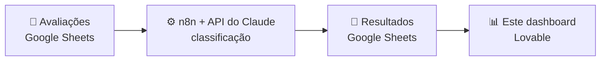

# 📊 Painel de Avaliações de Delivery com IA

Dashboard web que mostra os resultados do meu [**Classificador de Avaliações com IA**](https://github.com/roberta-sarah/classificador-avaliacoes-ia): avaliações de restaurantes classificadas automaticamente por **problema, sentimento e urgência** usando n8n e a API do Claude.

🔗 **Ver o dashboard funcionando:** https://painel-avaliacoes-ia.lovable.app

> Construído com **Lovable** (vibe coding), a partir de um prompt que escrevi descrevendo os indicadores, gráficos e filtros necessários.

---

## 🎯 Para que serve

O classificador transforma avaliações em texto livre em dados estruturados. Este painel responde, de forma visual:

- Quantas avaliações são negativas?
- Quais problemas aparecem com mais frequência?
- Quais avaliações precisam de **atenção imediata** (urgência alta, como riscos à saúde)?
- Como está o sentimento dos clientes em cada restaurante?

## 🔄 Como os dois projetos se conectam



1. **[Classificador](https://github.com/roberta-sarah/classificador-avaliacoes-ia):** o n8n envia cada avaliação para a API do Claude, que devolve problemas, sentimento, urgência e resumo
2. **Dashboard (este repositório):** apresenta os resultados em indicadores, gráficos e uma tabela filtrável

## ✨ Funcionalidades

- **Indicadores no topo:** total de avaliações, % negativas e quantidade de urgência alta
- **Problemas mais frequentes:** gráfico de barras (a coluna de problemas é separada por vírgulas e cada categoria é contada)
- **Distribuição de urgência:** baixa, média e alta
- **Sentimento por restaurante**
- **Tabela com filtros** por restaurante e por urgência, com **destaque em vermelho** para urgência alta

## ✅ Conferência dos dados

Conferi os números do painel com a planilha de resultados do classificador: total de **20 avaliações** e **2 de urgência alta** (hambúrguer cru e pedido com alergia).

## 🛠️ Tecnologias

| Camada | Ferramenta |
|---|---|
| Criação (vibe coding) | Lovable |
| Interface | React + TypeScript |
| Framework | TanStack Start (com Vite) |
| Componentes visuais | shadcn/ui |
| Testes (configurados) | Vitest |

<details>
<summary><strong>📝 Prompt usado no Lovable</strong></summary>

```
Crie um dashboard web em português chamado "Painel de Avaliações de Delivery com IA".

Contexto: as avaliações abaixo foram classificadas automaticamente por uma automação
no n8n que usa a API do Claude. Cada linha tem: id, restaurante, avaliacao, problemas
(pode ter mais de um, separados por vírgula), sentimento (positivo, negativo, misto),
urgencia (baixa, media, alta) e resumo.

O dashboard deve ter:
1. Cartões no topo: total de avaliações, % de avaliações negativas e quantidade de urgência alta.
2. Gráfico de barras com os problemas mais frequentes (separe a coluna "problemas" pelas
   vírgulas e conte cada categoria).
3. Gráfico com a distribuição de urgência (baixa, média, alta).
4. Gráfico de sentimento por restaurante.
5. Tabela com todas as avaliações, com filtros por restaurante e por urgência.
   Destaque em vermelho as linhas de urgência alta.
6. Rodapé com o texto: "Dados fictícios · Classificação feita com n8n + API do Claude"
   e um link para o repositório do classificador.

Design limpo, moderno e responsivo. Não use logos nem marcas de empresas reais.

Dados: [resultados exportados da planilha do classificador]
```

</details>

Os dados são **fictícios**.

**Autora:** Roberta Sarah · [LinkedIn](https://linkedin.com/in/roberta-sarah) · [GitHub](https://github.com/roberta-sarah)
